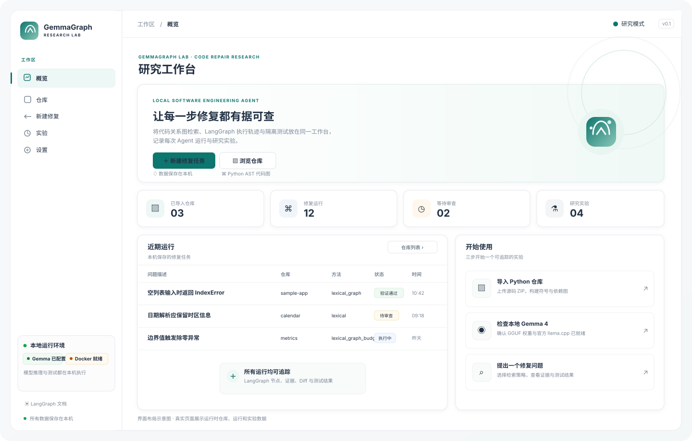
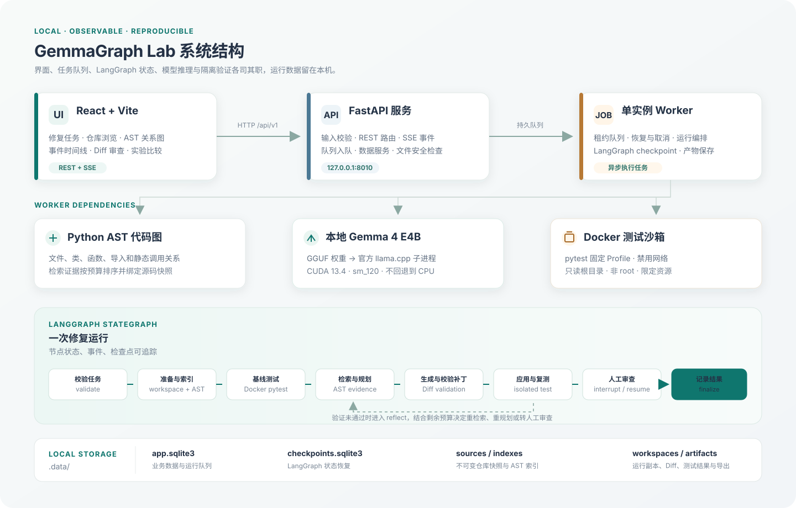

# GemmaGraph Lab

GemmaGraph Lab 是一个面向本地代码修复与研究实验的工作台。它将 **Python AST 代码关系图、LangGraph 有状态执行、Gemma 4 本地推理、Docker 隔离测试和人工 Diff 审查**串成可追踪的运行记录。

默认配置使用本机 Gemma 4 E4B QAT Q4 GGUF 权重，通过 Google Gemma 文档支持的 llama.cpp 集成方式运行；项目不要求云端模型 API key。网页、API、SQLite 数据、模型权重和运行产物都可以留在本机。

> 本项目用于可重复的代码修复实验。一次 Agent 运行、界面截图或 LangGraph 执行成功本身不构成研究结论；应根据真实任务、固定数据集和验证结果报告实验发现。

## 工作台预览



上图按当前概览页组件绘制，数值和任务行仅用于展示布局，不是某次真实运行的截图或结果。工作台页面包括概览、仓库与 AST 图、新建修复、运行审查、实验以及本地环境设置。

## 系统架构



前端通过 REST 与 SSE 连接 FastAPI。API 负责校验输入、保存业务记录并将任务放入 SQLite 队列；单实例 Worker 执行 LangGraph。图中的本地模型通过官方上游 llama.cpp 子进程调用，候选补丁在每个运行专属的工作副本中经过 Docker 测试，再进入人工审查。

## 功能概览

- **仓库快照**：上传 Python 源码 ZIP；校验路径、大小和链接后，保存不可变快照并计算树哈希。
- **代码关系图**：解析 Python 文件中的类、函数、导入和静态调用关系；网页提供文件树、只读源码和可搜索的关系子图。
- **LangGraph 修复流程**：依次校验任务、准备工作副本、构建索引、收集基线、检索证据、规划与生成补丁、验证 Diff、隔离测试、人工审查并记录结果。
- **可恢复人工审查**：图在 `human_review` 节点中断并保存 checkpoint；用户可接受、拒绝或给出修改意见后，从同一运行恢复。
- **实时运行记录**：前端用 SSE 展示节点状态、检索证据、计划、补丁和测试事件；网络重连后可按事件序号补读历史。
- **成组实验**：导入 JSONL 任务集，对 `lexical`、`lexical_graph`、`lexical_graph_budget` 检索策略和多个 seed 运行比较，并导出结果包。
- **安全隔离**：模型只能建议补丁；Diff 会进行路径和格式校验，再应用到运行专属副本。测试在关闭网络、资源受限的非 root Docker 容器中执行。
- **复现信息**：保存模型、权重摘要、提示词、任务集哈希、预算、检索方法、测试 Profile、运行事件及产物。未获得的供应商 token 数保持未知；本地字符估算会显式标注为估算。

首期范围是单用户本机使用。API 默认只绑定 `127.0.0.1`。目前只解析 Python AST 并运行 `python-pytest` Profile；不包含模型训练、远程 Git、Kaggle 官方评分或自动提交 PR。根目录也保留 Google GenAI 和兼容 HTTP provider 适配器，但当前默认配置是本地 `llama_cpp_local`。

## 技术组成

| 层        | 实现                                       | 作用                         |
| -------- | ---------------------------------------- | -------------------------- |
| 前端       | React 19、TypeScript、Vite、TanStack Query  | 单页工作台、REST/SSE 客户端和浏览器状态管理 |
| 代码可视化    | React Flow、Monaco Editor                 | 展示 AST 关系图、只读源码及补丁 Diff    |
| API      | FastAPI、Pydantic、Uvicorn                 | 本地 REST API、上传验证、状态查询与 SSE |
| Agent 编排 | LangGraph StateGraph、SQLite checkpointer | 节点路由、循环修复、人工 interrupt 与恢复 |
| 业务状态     | SQLite、aiosqlite                         | 仓库、运行、事件、任务队列、数据集与实验       |
| 模型       | Gemma 4 E4B QAT Q4 GGUF、官方上游 llama.cpp   | 在本地 CUDA GPU 上生成计划、补丁和反思结果 |
| 测试执行     | Docker Engine                            | 在隔离容器内运行固定的 pytest Profile |

llama.cpp 依照 [Google Gemma 官方集成文档](https://ai.google.dev/gemma/docs/integrations/llamacpp)使用，源码固定为 [ggml-org/llama.cpp v0.7.0](https://github.com/ggml-org/llama.cpp/releases/tag/v0.7.0)。llama.cpp 是 Google 文档支持的开源推理框架，不是 Google 自有框架；本项目不会使用机器上其他来源的 llama.cpp 分支。

## 环境要求

- Linux 本机环境；项目脚本以 Bash 为运行环境。
- Python 3.11 或更高版本、[uv](https://docs.astral.sh/uv/)。
- Node.js 22 或更高版本、pnpm 11。
- Git、CMake、C++ 编译器。
- NVIDIA 驱动、官方 CUDA Toolkit 13.4 和支持 CUDA 的 GPU。当前目标架构设为 `sm_120`（CUDA 架构值 `120`）。
- Docker Engine，且当前用户能访问 Docker daemon；运行代码测试需要 Docker。
- 本地 Gemma 4 E4B QAT Q4 GGUF 文件；模型权重需要单独获取，不包含在仓库中，并通过 `MODEL_PATH` 配置。
- 初次安装需要访问 Python、npm/pnpm 软件源和官方 llama.cpp GitHub 仓库。

模型文件必须是本工程配置的 Gemma 4 GGUF。源码构建会下载固定版本的官方 llama.cpp；Docker 沙箱镜像需能构建并启动。

## 安装与启动

### 一条命令完成验证并启动

克隆仓库后，在宿主机终端执行：

```bash
git clone https://github.com/DeRuiChen258/GemmaGraph_Lab.git
cd GemmaGraph_Lab
cp -n .env.example .env
make verify-local && make dev
```

`cp -n` 只在 `.env` 尚不存在时创建配置文件。检查配置中的 `MODEL_PATH` 是否指向本机 GGUF 后，再运行验证命令。

`make verify-local` 按顺序执行 CUDA 编译和 GPU 内核探测、Python 与前端依赖安装、官方 llama.cpp CUDA 构建、后端回归、前端生产构建、本地模型检查与真实短生成、Docker 沙箱镜像构建。它遇到错误会停止；日志和模型回复保存在 `.data/validation/<UTC 时间>/`。全部通过后，`make dev` 同时启动 API、单 Worker 和 Vite 开发服务器。

> `make verify-local` 是构建与短生成检查，不会自动导入任务或完成一个代码修复实验。要验证完整修复流程，请在工作台导入测试仓库并新建任务。

### 首次安装与分步启动

如果需要逐步查看或定位某个环节，可在工程根目录按顺序运行：

```bash
cd GemmaGraph_Lab
make cuda-check
./install.sh
make llama-cpp
make model-check
make model-smoke
docker build -t gemmagraph-sandbox:0.1 infra/sandbox
make dev
```

其中 `make model-check` 只检查 GGUF、推理二进制和构建来源记录，不做推理；`make model-smoke` 会真的加载模型并生成短文本。CUDA 构建完成并不等于真实推理已通过，应查看 smoke 输出是否包含模型回复。

### 访问工作台

| 服务         | 地址                                                                         |
| ---------- | -------------------------------------------------------------------------- |
| 前端工作台      | [http://127.0.0.1:5173](http://127.0.0.1:5173)                             |
| FastAPI 文档 | [http://127.0.0.1:8010/docs](http://127.0.0.1:8010/docs)                   |
| API 健康状态   | [http://127.0.0.1:8010/api/v1/health](http://127.0.0.1:8010/api/v1/health) |

开发脚本会在同一个终端里管理 API、Worker 和前端；按 `Ctrl+C` 停止它们。修复任务只有在本地模型和 Docker 都可用时才可完成验证；设置页会显示运行前置条件。

需要分别观察进程日志时，可在三个终端中执行：

```bash
uv run --project backend gemmagraph-api
```

```bash
uv run --project backend gemmagraph-worker
```

```bash
pnpm --dir frontend dev
```

### 常用检查命令

```bash
make cuda-check        # CUDA 13.4 编译与 GPU kernel 探测
make llama-cpp         # 构建固定版本官方 llama.cpp CUDA 运行时
make model-check       # 检查模型文件、运行时与来源 manifest
make model-smoke       # 实际加载 Gemma 4 并生成短回复
make test              # 后端 pytest 回归
make build             # 前端 TypeScript 检查与 Vite 生产构建
make api-schema        # 从 FastAPI OpenAPI 生成前端 API schema
```

`make verify-local` 会生成当前构建和真实模型短生成记录；已知状态、限制和逐项验证结果见 [验证记录](docs/validation.zh-CN.md)。协议夹具测试用于检查工程行为，不能代替 `make model-smoke` 的实际推理。

## 配置说明

后端从工程根目录 `.env` 读取配置。`.env` 已加入忽略规则，不应把私有配置或密钥提交到版本控制。

| 环境变量                      | 默认值                      | 说明                                   |
| ------------------------- | ------------------------ | ------------------------------------ |
| `MODEL_PROVIDER`          | `llama_cpp_local`        | 当前使用本地 llama.cpp 子进程 provider。       |
| `MODEL_ID`                | `gemma-4-E4B-QAT-Q4`     | 写入运行复现信息的模型名称。                       |
| `MODEL_PATH`              | `/path/to/gemma-4-E4B_q4_0-it.gguf` | 本地权重绝对路径；复制 `.env.example` 后改成实际位置。 |
| `LLAMA_CPP_DIR`           | `.runtime/llama.cpp`     | 固定版本官方源码、构建二进制与来源记录目录。               |
| `MODEL_GPU_LAYERS`        | `999`                    | 请求将所有可卸载层放到 GPU；当前设置不自动回退到 CPU。      |
| `MODEL_THREADS`           | `8`                      | CPU 侧运行线程数。                          |
| `MODEL_CONTEXT_WINDOW`    | `16384`                  | 本次推理实际分配的上下文长度，不会自动分配 GGUF 声明的最大上下文。 |
| `MODEL_MAX_OUTPUT_TOKENS` | `2048`                   | 单次生成 token 上限。                       |
| `MODEL_TIMEOUT_SECONDS`   | `600`                    | 模型加载与生成的总超时时间。                       |
| `DATA_DIR`                | `.data`                  | SQLite 数据、源码快照、索引、工作副本、产物与验证记录目录。    |
| `SANDBOX_IMAGE`           | `gemmagraph-sandbox:0.1` | Docker 测试镜像名称。                       |
| `API_HOST` / `API_PORT`   | `127.0.0.1` / `8010`     | 本地 API 监听地址和端口。                      |
| `ALLOWED_ORIGINS`         | 本机 Vite 地址列表             | 允许访问 API 的本机前端来源。                    |

模型、运行时和 CUDA 构建的详细说明见[本地 Gemma 4 推理与调试](docs/local-inference.zh-CN.md)。修改 `.env` 后需重启 API 与 Worker。

## 工作台页面

| 路由                            | 页面用途                                                     |
| ----------------------------- | -------------------------------------------------------- |
| `/overview`                   | 仓库、运行、待审查项和实验统计；展示近期任务与快速入口。                             |
| `/repositories`               | 上传 Python ZIP，查看仓库索引状态、文件数量和符号数量。                        |
| `/repositories/:repositoryId` | 浏览固定快照、查看只读源码、搜索 AST 符号及关系子图。                            |
| `/runs/new`                   | 选择仓库、填写修复描述、选择检索策略并创建任务。                                 |
| `/runs/:runId`                | 查看 LangGraph 流程图、SSE 事件、证据、Diff、基线与候选补丁测试；执行接受、拒绝、修改或取消。 |
| `/experiments`                | 导入 JSONL 数据集，比较检索方法与 seeds，查看进度并导出复现 ZIP。                |
| `/settings`                   | 检查模型与 Docker 状态，查看测试 Profile，并调整之后新任务的默认预算。              |

## LangGraph 执行流程

正常路径为：

```text
validate_task
  → prepare_workspace
  → index_repository
  → collect_baseline
  → retrieve_context
  → plan_fix
  → generate_patch
  → validate_patch
  → apply_patch
  → verify_patch
  → human_review
  → finalize
```

补丁格式或测试验证未通过时，流程进入 `reflect`，根据失败摘要与剩余预算决定再次检索、重规划、重新生成补丁、转人工审查或结束。每个节点通过运行事件记录开始、完成或失败。人工审查使用 LangGraph `interrupt`；恢复时检查 `review_id` 与补丁哈希是否匹配，避免审查对象发生变化。

验证结果和人工决策是两个独立字段：接受补丁不会自动把失败测试改成通过，拒绝补丁也不会删除技术验证记录。

## API 与数据格式

所有业务路由以 `/api/v1` 为前缀。完整交互式文档在 API 启动后访问 `/docs`；当前 OpenAPI 快照位于 [backend/openapi.json](backend/openapi.json)。主要路由包括：

| 路由                                                         | 用途                       |
| ---------------------------------------------------------- | ------------------------ |
| `/health`、`/overview`、`/workflow`、`/settings`              | 健康状态、工作台统计、图结构与设置。       |
| `/providers/status`、`/providers/check`                     | 查看本地模型和运行时状态；检查接口不生成文本。  |
| `/repositories`、`/repositories/{id}/tree`、`/file`、`/graph` | 导入仓库并读取快照、源码与 AST 子图。    |
| `/runs`、`/runs/{id}`、`/events`、`/resume`、`/cancel`         | 创建和管理修复任务；SSE 事件可以按序号续读。 |
| `/datasets/import`、`/datasets`                             | 导入并查看 JSONL 任务集。         |
| `/experiments`、`/experiments/{id}/export`                  | 创建成组实验、取消并导出复现包。         |
| `/runs/{id}/artifacts`、`/artifacts/{artifact_id}`          | 列出或读取补丁、测试输出与其他运行产物。     |

JSONL 任务格式和实验指标定义见[任务集、指标与导出](docs/data-format.zh-CN.md)。简化示例：

```jsonl
{"instance_id":"bug-001","repository_key":"calculator","issue":"normalize_items 在空列表输入时会抛出 IndexError，应返回空列表。"}
```

导入任务集时需要将 `repository_key` 映射到已导入的本地仓库。导出实验包包含任务、逐项结果、指标、配置、SHA-256 manifest 和复现说明。

## 本地数据与安全边界

默认数据位置为工程目录下的 `.data/`：

| 路径                          | 内容                                      |
| --------------------------- | --------------------------------------- |
| `.data/app.sqlite3`         | 仓库、运行、队列、事件、数据集和实验等业务数据。                |
| `.data/checkpoints.sqlite3` | 独立的 LangGraph 状态 checkpoint。            |
| `.data/sources/`            | 按快照 ID 保存的不可变仓库源文件。                     |
| `.data/indexes/`            | 按源码树哈希缓存的 AST 索引 JSON。                  |
| `.data/workspaces/`         | 每个修复运行独立的源码工作副本。                        |
| `.data/artifacts/`          | Diff、计划、基线与候选测试输出等运行产物。                 |
| `.data/exports/`            | 实验导出文件。                                 |
| `.data/validation/`         | `make verify-local` 日志、模型检查 JSON 和生成结果。 |

LangGraph checkpoint 和业务 SQLite 使用不同数据库文件，二者不会跨库原子提交；运行恢复还依赖持久事件和队列租约。复现实验时应保留整个 `.data/` 目录以及对应模型和运行时来源记录。

构建与依赖安装会生成 `.runtime/llama.cpp/`（官方源码、`build/bin/llama-completion` 和 `build/gemmagraph-runtime.json`）、`backend/.venv/`、`frontend/node_modules/`、`frontend/dist/`、`.uv-cache/` 与 `.pnpm-store/`。这些路径已加入忽略规则；官方运行时 manifest 记录源码 commit、二进制 SHA-256、设备、CUDA Toolkit 和编译器信息。

仓库快照不会被 Agent 原地修改。上传仓库和模型输出均视作不可信输入；源码 ZIP 会检查路径穿越与符号链接，模型 Diff 会限制可修改路径并在每次运行独立副本中应用。pytest 只在 Docker 容器中运行：禁用网络、容器根目录只读、以非 root 用户执行，并限制内存、CPU 和 PID 数。Docker 不可用时，任务会记录环境阻塞，不会退回宿主机执行上传代码。

## 完整项目结构

下表列出当前仓库中的源码、配置、文档和构建文件。`node_modules`、虚拟环境、缓存、构建结果、`.data/`、`.runtime/` 和本机 `.env` 是生成或本机数据，不属于提交的项目源码；其主要内容见下方的本机生成目录说明。

```text
Kaggle_Gemma4/
├── README.md                         项目介绍、完整结构、配置与操作指南
├── .env.example                      本地模型、CUDA、API 与数据目录配置模板
├── .gitignore                        忽略本机密钥、模型运行时、数据、缓存和构建产物
├── .npmrc                            pnpm 行为设置
├── Makefile                          安装、CUDA、运行时、测试与启动快捷命令
├── install.sh                        安装 Python 与前端依赖
├── backend/
│   ├── openapi.json                  FastAPI OpenAPI schema 快照
│   ├── pyproject.toml                Python 包、依赖组、入口点与 Ruff/pytest 配置
│   ├── uv.lock                       Python 依赖锁文件
│   ├── tests/                        后端 API、图流程、沙箱、模型和恢复测试
│   └── src/gemmagraph/
│       ├── __init__.py               Python 包声明
│       ├── main.py                   FastAPI app、生命周期、CORS 与异常处理
│       ├── worker.py                 单实例租约 Worker、任务恢复、取消与心跳
│       ├── settings.py               环境配置、模型状态、默认预算和测试 Profile
│       ├── db.py                     SQLite 业务存储与事务辅助
│       ├── schema.sql                业务表结构
│       ├── contracts.py              API 请求与响应数据模型
│       ├── errors.py                 结构化应用错误
│       ├── event_store.py            运行事件持久化、序号与 SSE 续读
│       ├── queue.py                  SQLite 任务队列、租约与幂等处理
│       ├── agent/                    LangGraph 状态、节点、预算和 checkpoint
│       ├── api/                      REST/SSE 路由
│       ├── codegraph/                Python AST 解析、索引与检索
│       ├── prompts/                  规划、补丁生成和反思提示词
│       ├── providers/                本地模型及可选 HTTP provider 适配层
│       ├── sandbox/                  补丁策略与 Docker 隔离执行器
│       └── services/                 仓库、运行、数据集、实验与产物业务服务
├── frontend/
│   ├── index.html                    Vite 页面入口
│   ├── package.json                  前端依赖与开发/构建脚本
│   ├── pnpm-lock.yaml                前端依赖锁文件
│   ├── pnpm-workspace.yaml           pnpm workspace 与允许执行的依赖构建脚本
│   ├── tsconfig*.json                 TypeScript 项目配置
│   ├── vite.config.ts                Vite、开发代理与生产构建配置
│   ├── public/mark.svg               GemmaGraph 图标
│   └── src/                          页面、组件、API 客户端、事件与样式
├── configs/
│   ├── defaults.yaml                 Agent 默认预算与检索权重
│   └── test_profiles.yaml            允许的容器测试命令及资源限制
├── docs/
│   ├── architecture.zh-CN.md        架构、LangGraph、事件与 API 说明
│   ├── data-format.zh-CN.md         JSONL 任务格式、指标和导出包定义
│   ├── local-inference.zh-CN.md    本地 Gemma 4、CUDA 构建与推理调试
│   ├── validation.zh-CN.md         验证记录、环境边界与待确认项
│   └── images/                      README 架构图和界面布局图（SVG）
├── infra/sandbox/Dockerfile         pytest 隔离运行镜像
├── scripts/                         CUDA、运行时构建、开发启动与 smoke 脚本
└── examples/                        示例文件预留目录（当前为空）
```

### 后端文件职责

#### `backend/src/gemmagraph/agent/`

| 文件                           | 职责                                    |
| ---------------------------- | ------------------------------------- |
| `__init__.py`                | Agent 包声明。                            |
| `budgets.py`                 | 依据服务端运行配置计算尝试次数、模型调用与活动时间等剩余预算。       |
| `checkpoints.py`             | 打开 LangGraph SQLite checkpoint saver。 |
| `graph.py`                   | 构建 StateGraph、节点包装、事件记录、执行耗时与条件路由。    |
| `model_outputs.py`           | 解析模型输出、校验结构化计划并记录真实或未知的 token 用量。     |
| `runtime.py`                 | 组装 Agent 依赖、构建图并执行/恢复一条运行。            |
| `state.py`                   | 定义 LangGraph 节点共享的 `AgentState` 类型。   |
| `nodes/__init__.py`          | 聚合并导出工作流节点。                           |
| `nodes/validate_task.py`     | 检查模型、沙箱、Profile 和任务输入等执行前提。           |
| `nodes/prepare_workspace.py` | 从不可变仓库快照创建运行专属工作副本。                   |
| `nodes/index_repository.py`  | 构建或加载 AST 索引，并更新仓库索引状态。               |
| `nodes/collect_baseline.py`  | 在沙箱内执行初始测试并保存基线产物。                    |
| `nodes/retrieve_context.py`  | 根据检索方法、失败信息和预算选择代码证据。                 |
| `nodes/plan_fix.py`          | 调用模型生成受证据约束的修复计划。                     |
| `nodes/generate_patch.py`    | 调用模型生成 Diff，并保存补丁产物。                  |
| `nodes/validate_patch.py`    | 校验 Diff 语法、目标路径和可修改文件数量。              |
| `nodes/apply_patch.py`       | 将已校验补丁应用到运行专属工作副本。                    |
| `nodes/verify_patch.py`      | 在 Docker 中复测，判定基线是否复现且补丁是否通过。         |
| `nodes/reflect.py`           | 根据失败摘要调用反思提示词，并在预算范围内选择下一步。           |
| `nodes/human_review.py`      | 触发人工 interrupt，校验审查 ID/补丁哈希并处理恢复决策。   |
| `nodes/finalize.py`          | 汇总技术结果、人工决定和最终运行摘要。                   |

#### `backend/src/gemmagraph/api/`

| 文件                | 职责                               |
| ----------------- | -------------------------------- |
| `__init__.py`     | API 路由包声明。                       |
| `system.py`       | 健康、概览、工作流、设置、模型与沙箱状态路由。          |
| `repositories.py` | 仓库上传、列表、快照详情、文件树、源码和关系图路由。       |
| `runs.py`         | 修复运行创建/查询、事件历史、SSE、取消、恢复和产物列表路由。 |
| `experiments.py`  | 实验创建、查询、取消与导出路由。                 |
| `datasets.py`     | JSONL 任务集导入与查询路由。                |
| `artifacts.py`    | 单个运行产物下载路由。                      |

#### `backend/src/gemmagraph/codegraph/`

| 文件                 | 职责                             |
| ------------------ | ------------------------------ |
| `__init__.py`      | 代码图包声明。                        |
| `schema.py`        | 定义符号、关系和索引的数据模型。               |
| `python_parser.py` | 以 Python AST 提取定义、作用域、导入及静态调用。 |
| `builder.py`       | 遍历固定仓库快照并汇总 AST 代码索引。          |
| `retrieval.py`     | 计算词法相关度、扩展图邻居并按预算排序证据。         |
| `store.py`         | 按源码树哈希缓存索引并生成前端关系子图响应。         |

#### `backend/src/gemmagraph/providers/`

| 文件                   | 职责                                               |
| -------------------- | ------------------------------------------------ |
| `__init__.py`        | provider 包声明。                                    |
| `base.py`            | 定义模型 Provider 协议。                                |
| `factory.py`         | 根据设置实例化本地或兼容 API Provider。                       |
| `local_model.py`     | 读取 GGUF 元信息、文件属性和 SHA-256。                       |
| `llama_cpp_local.py` | 检查官方构建来源，准备 prompt 并运行本地 `llama-completion` 子进程。 |
| `google_genai.py`    | 可选 Google GenAI API Provider 实现；默认配置不使用。         |
| `compatible_http.py` | 可选 OpenAI 兼容 HTTP Provider 实现；默认配置不使用。           |

#### `backend/src/gemmagraph/sandbox/`

| 文件                 | 职责                              |
| ------------------ | ------------------------------- |
| `__init__.py`      | 沙箱包声明。                          |
| `policy.py`        | 校验 Profile 和镜像配置。               |
| `patches.py`       | 检查补丁格式、可写路径及变更规模，并安全应用 Diff。    |
| `docker_runner.py` | 探测 Docker、创建受限容器、收集输出和停止运行中的容器。 |

#### `backend/src/gemmagraph/services/`

| 文件                | 职责                          |
| ----------------- | --------------------------- |
| `__init__.py`     | 业务服务包声明。                    |
| `workspaces.py`   | 管理快照和工作区路径；拒绝越界路径与不允许的文件。   |
| `repositories.py` | 检查并导入 ZIP、计算源码树哈希、读取只读源码内容。 |
| `runs.py`         | 构建运行配置快照、校验幂等键并创建或恢复任务。     |
| `artifacts.py`    | 写入并读取带 SHA-256 与元数据的运行产物。   |
| `datasets.py`     | 解析、校验 JSONL 任务集并映射到本地仓库。    |
| `experiments.py`  | 展开实验方法和 seeds、创建子运行并汇总实验详情。 |

#### `backend/src/gemmagraph/prompts/`

| 文件             | 职责                         |
| -------------- | -------------------------- |
| `__init__.py`  | 加载和渲染版本化 Markdown 提示词。     |
| `planner.md`   | 约束修复计划的结构与证据引用。            |
| `patcher.md`   | 要求模型依据证据输出受限 unified diff。 |
| `reflector.md` | 根据验证失败与剩余预算建议后续动作。         |

#### `backend/tests/`

| 文件                           | 覆盖范围                       |
| ---------------------------- | -------------------------- |
| `conftest.py`                | 临时数据库、设置、快照与服务依赖测试夹具。      |
| `test_api.py`                | FastAPI 路由、请求验证和响应行为。      |
| `test_run_graph.py`          | LangGraph 工作流执行和节点路由。      |
| `test_patch_safety.py`       | Diff 路径与补丁安全策略。            |
| `test_sandbox_cleanup.py`    | Docker 运行资源清理与终止行为。        |
| `test_local_provider.py`     | 本地 Provider 参数、检查和子进程响应处理。 |
| `test_usage_and_recovery.py` | 用量记录、checkpoint 恢复与人工审查恢复。 |
| `test_experiment_usage.py`   | 实验任务的用量和指标汇总。              |

### 前端文件职责

#### `frontend/src/`

| 路径                             | 职责                                     |
| ------------------------------ | -------------------------------------- |
| `main.tsx`                     | 初始化 React、路由、Query Client 与全局样式。       |
| `App.tsx`                      | 应用错误边界、懒加载页面和前端路由。                     |
| `styles.css`                   | 工作台布局、主题、表单、代码图、运行审查和响应式样式。            |
| `vite-env.d.ts`                | Vite 与静态资源模块的 TypeScript 类型声明。         |
| `api/client.ts`                | REST 请求封装、错误/Request ID 处理以及业务 API 函数。 |
| `api/events.ts`                | 校验、排序和去重运行事件。                          |
| `api/query.ts`                 | TanStack Query 使用的缓存键。                 |
| `api/types.ts`                 | 前端业务类型。                                |
| `components/AppShell.tsx`      | 侧边导航、顶栏和本地模型/Docker 状态。                |
| `components/ui.tsx`            | 按钮、面板、提示、徽标、模态框、加载和表单基础组件。             |
| `components/ImportDialog.tsx`  | 仓库 ZIP 与任务 JSONL 上传弹窗及仓库键映射。           |
| `components/MonacoEditor.tsx`  | 只读源码编辑器和 unified diff 双栏审查器。           |
| `components/WorkflowGraph.tsx` | 显示 LangGraph 节点及当前运行状态。                |
| `hooks/useRunEvents.ts`        | 加载运行事件历史、打开 SSE 并维护事件流状态。              |
| `lib/apply-diff.ts`            | 前端补丁展示和相关 Diff 处理辅助函数。                 |
| `lib/format.ts`                | 日期、数值、耗时、错误等格式化函数。                     |
| `lib/graph-layout.ts`          | 将代码关系节点和边布局为 React Flow 图形。            |
| `pages/OverviewPage.tsx`       | 工作区统计、近期运行和快速入口。                       |
| `pages/RepositoriesPage.tsx`   | 仓库列表和 ZIP 导入入口。                        |
| `pages/RepositoryPage.tsx`     | 源码快照、文件浏览器、Monaco 和 AST 关系图。           |
| `pages/NewRunPage.tsx`         | 选择仓库、问题描述和检索策略，创建修复运行。                 |
| `pages/RunPage.tsx`            | 运行图、事件、证据、Diff、测试结果、审查与取消操作。           |
| `pages/ExperimentsPage.tsx`    | JSONL 数据集导入、实验创建、状态浏览及结果导出。            |
| `pages/SettingsPage.tsx`       | 本地模型、CUDA/运行时、Docker Profile 与运行预算状态。  |
| `pages/NotFoundPage.tsx`       | 未匹配路由的 404 页面。                         |

#### 前端根目录文件

| 文件                             | 职责                                           |
| ------------------------------ | -------------------------------------------- |
| `frontend/index.html`          | Vite HTML 入口及应用挂载点。                          |
| `frontend/package.json`        | 依赖清单、pnpm 版本以及 `dev`、`build`、`typecheck` 脚本。 |
| `frontend/pnpm-lock.yaml`      | 锁定前端依赖版本。                                    |
| `frontend/pnpm-workspace.yaml` | pnpm workspace 与依赖安装脚本白名单。                   |
| `frontend/tsconfig.json`       | TypeScript 项目引用配置。                           |
| `frontend/tsconfig.app.json`   | 浏览器应用的 TypeScript 编译选项。                      |
| `frontend/tsconfig.node.json`  | Vite 配置等 Node 侧代码的 TypeScript 选项。            |
| `frontend/vite.config.ts`      | React 插件、源码别名、开发服务器和 `/api` 代理。              |
| `frontend/public/mark.svg`     | 侧边栏和概览页使用的品牌图形。                              |

### 其他工程文件

| 路径                                  | 职责                                              |
| ----------------------------------- | ----------------------------------------------- |
| `Makefile`                          | 将安装、CUDA 检查、模型 smoke、测试和开发启动命令汇总为 make targets。 |
| `.env.example`                      | 可提交的无密钥本地开发配置示例。                                |
| `.npmrc`                            | pnpm 安装及依赖来源选项。                                 |
| `.gitignore`                        | 忽略 `.env`、`.data/`、`.runtime/`、依赖、缓存和产物。        |
| `install.sh`                        | 安装锁定的后端依赖及前端依赖。                                 |
| `backend/pyproject.toml`            | Python 包元数据、生产/开发依赖和工具配置。                       |
| `backend/uv.lock`                   | Python 依赖解析锁文件。                                 |
| `backend/openapi.json`              | 前端 API 类型生成使用的 OpenAPI schema。                  |
| `configs/defaults.yaml`             | 最大尝试次数、模型调用数、活动时间、证据预算、检索权重等默认值。                |
| `configs/test_profiles.yaml`        | pytest 容器命令、文件白名单、内存、CPU 和 PID 限制。              |
| `infra/sandbox/Dockerfile`          | 构建含固定 pytest 版本的非 root 隔离测试镜像。                  |
| `scripts/cuda-check.sh`             | 编译并执行 CUDA 设备/内核诊断。                             |
| `scripts/cuda-probe.cu`             | CUDA runtime、driver、显卡能力和 kernel 的诊断程序。         |
| `scripts/install-llama-cpp.sh`      | 获取并构建固定 tag 的官方 llama.cpp，写入来源与二进制摘要 manifest。  |
| `scripts/model-smoke.py`            | 检查本地 GGUF/运行时或执行真实短生成。                          |
| `scripts/verify-local.sh`           | 串联 CUDA、依赖、运行时、回归、前端构建、模型生成和 Docker 构建。         |
| `scripts/dev.sh`                    | 同时启动 API、Worker 和 Vite，并在退出时清理进程。               |
| `scripts/generate-api.sh`           | 从后端 OpenAPI schema 生成前端 API schema 类型。          |
| `docs/architecture.zh-CN.md`        | 进程职责、LangGraph 路径、事件语义与 REST 路由说明。              |
| `docs/data-format.zh-CN.md`         | JSONL 任务字段、实验口径和导出包说明。                          |
| `docs/local-inference.zh-CN.md`     | GGUF、llama.cpp 官方来源、CUDA 构建、推理配置和调试顺序。          |
| `docs/validation.zh-CN.md`          | 已执行检查的证据、当前限制和未完成验证。                            |
| `docs/images/architecture.svg`      | 本 README 的系统架构图。                                |
| `docs/images/workbench-preview.svg` | 本 README 的前端布局示意图。                              |

## 项目文档

- [架构与 API](docs/architecture.zh-CN.md)
- [本地 Gemma 4 推理与调试](docs/local-inference.zh-CN.md)
- [任务集、指标与导出](docs/data-format.zh-CN.md)
- [构建验证记录](docs/validation.zh-CN.md)

## 许可证

本项目以 [MIT License](LICENSE) 发布。模型权重、依赖项和 Docker 基础镜像仍分别遵循其各自的许可条款。
